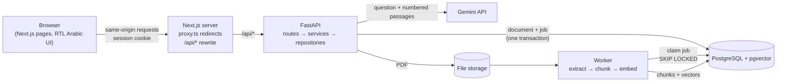

# Daleel · دليل

**Ask your documents questions in Arabic or English, and get answers that cite the exact page they came from.**

Upload a long PDF (a university handbook, a company policy, a regulation), ask a question in plain language, and Daleel answers using only that document. Every answer points to the page and passage it is based on, and when the document does not contain the answer, Daleel says so instead of guessing.

> **Status:** all three phases are built and tested locally: accounts, document processing, and questions with cited answers. Not yet done: running CI on GitHub and deploying a public demo. See [Roadmap](#roadmap).

## What it does

1. **Upload** a PDF. It is processed in the background: text extracted, cleaned for Arabic, split into passages, embedded.
2. **Ask** in Arabic (including dialect) or English, about Arabic or English documents.
3. **Read the answer with citations.** Each claim ends with a number like [1]. Click it to open the page with the exact passage highlighted.
4. **Get "not found" instead of a guess** when your documents do not contain the answer.

## Why this project

Most "chat with your PDF" demos are English-only and happily invent answers. Daleel focuses on two things they skip:

- **Arabic first.** The interface is right-to-left Arabic, and the document pipeline is designed for Arabic text (normalisation, multilingual embeddings, Arabic evaluation questions).
- **Verifiable answers.** Answers are grounded in retrieved passages, citations are validated against what was actually retrieved, and retrieval quality is measured with an evaluation set rather than assumed.

## Tech stack

| Layer | Technology |
| --- | --- |
| Frontend | Next.js 16 (App Router), React 19, TypeScript (strict), Tailwind CSS 4, TanStack Query |
| API client | Generated from the backend's OpenAPI schema (`openapi-typescript` + `openapi-fetch`) |
| Backend | Python 3.12, FastAPI, Pydantic v2, SQLAlchemy 2 |
| Database | PostgreSQL 16 + pgvector (HNSW index), migrations with Alembic |
| Documents | PyMuPDF (text + positions), Arabic normalisation, page-aware chunking |
| Embeddings | `paraphrase-multilingual-MiniLM-L12-v2` run locally with fastembed (ONNX, CPU, free) |
| Background jobs | Postgres job table + worker using `SELECT … FOR UPDATE SKIP LOCKED` |
| Search | Hybrid: pgvector cosine search + IDF-weighted keyword matching, fused with Reciprocal Rank Fusion |
| Answers | Gemini API (free tier, `gemini-3.5-flash-lite` by default) behind a provider interface, JSON output |
| PDF viewer | pdf.js, with the cited passage's rectangles highlighted on the page |
| Auth | Argon2id password hashing, JWT in an `httpOnly` `SameSite=Lax` cookie |
| Testing | pytest (against real Postgres), Playwright end-to-end tests (desktop + phone) |
| Tooling | uv, Ruff, ESLint, GitHub Actions, Docker Compose |

## Architecture



- The browser only talks to the Next.js origin. Next.js forwards `/api/*` to FastAPI, so the session cookie is same-origin and no CORS configuration is needed.
- The backend is layered: **routes** handle HTTP, **services** hold the rules (e.g. registration, login), **repositories** are the only code that queries tables.
- All errors use one JSON shape: `{"error": {"code", "message", "details"?}}`. Unexpected errors are logged server-side and never leak internals to the client.

### Document pipeline

Uploading returns immediately; the expensive work happens in a background worker:

1. **Validate at upload:** checks the file's bytes (not its name) are a PDF, rejects encrypted, oversized (20 MB) or very long (500 pages) files. The stored file is named by the server (`<user id>/<document id>.pdf`), never by the user.
2. **Queue:** the document row and its processing job are committed in the same transaction.
3. **Claim:** a worker takes the oldest job with `SELECT … FOR UPDATE SKIP LOCKED`, so several workers never process the same job. Jobs left "running" by a crashed worker are re-queued.
4. **Extract:** PyMuPDF reads text blocks with their positions. PDFs with no text layer (scans) fail with a clear `scanned_pdf` code.
5. **Normalise:** NFKC turns Arabic "presentation form" characters (common in PDFs) back into normal letters. A second, search-only form also removes diacritics and tatweel and unifies alef, ya and ta marbuta variants.
6. **Chunk:** passages of up to 450 characters with overlap, never crossing a page, each keeping its page number and rectangles for highlighting. The size comes from a measurement: the model reads at most 128 tokens (~3.9 Arabic characters per token), and larger chunks were being silently truncated.
7. **Embed and save:** vectors are computed outside any transaction, then chunks are replaced and the document marked `ready` in one short transaction. Retries never duplicate chunks; a document deleted mid-processing is discarded safely.

Failures are recorded as stable codes (shown in Arabic by the UI). Transient errors are retried up to 3 times; permanent ones (e.g. a scanned PDF) fail immediately and the user can retry manually.

### Answering a question

1. **Hybrid search** over the user's ready documents (never anyone else's): vector similarity finds passages with the same meaning, even across languages; keyword matching finds exact terms the small model misses. The two rankings are merged with Reciprocal Rank Fusion. A keyword result only counts if it contains at least 60% of the question's keywords, because one shared common word was measured to push correct answers down.
2. **Relevance floor:** passages that are neither somewhat similar nor share a keyword are dropped. If none are left, the answer is "not found" and the model is never called.
3. **Prompt:** the question plus numbered passages (`<passage id="1" document="…" page="3">`). Passage text is HTML-escaped so a document cannot close its tag and pose as instructions, and the rules tell the model to treat passages as data.
4. **Model** returns JSON `{"found": bool, "answer": "… [1]"}`.
5. **Citation validation in code, not trust:** markers pointing to passages that were not sent are removed, the rest renumbered 1..n, and an answer left with no valid citation is shown as "not found".
6. **Saved** with its sources (title, page, excerpt, rectangles). Sources keep their excerpt even if the document is later deleted.

Questions are rate limited per user (6/minute, 100/day by default) to protect the free API quota. Model failures return clear error codes and save nothing, so the user can simply ask again.

## Evaluation

`backend/eval/` holds 25 questions about the sample guide (Arabic, Gulf dialect, English, cross-lingual, and 5 the document cannot answer). `uv run python -m eval.run_eval` measures retrieval with the real model:

| Method | Recall@1 | Recall@3 | MRR |
| --- | --- | --- | --- |
| Vector only | 90% | 90% | 0.92 |
| Keyword only | 50% | 60% | 0.57 |
| **Hybrid (used)** | **95%** | **95%** | **0.96** |

What the numbers changed:
- Plain hybrid (no keyword coverage rule) scored **worse** at Recall@1 (70%) than vectors alone. The fix (only count keyword results matching ≥60% of the keywords) was chosen from this measurement.
- Unanswerable questions reached similarity scores as high as 0.67, above some answerable ones (0.32). So similarity cannot detect "not in the document"; the model makes that call, and the backend verifies citations.

Full table: [`backend/eval/results.md`](backend/eval/results.md). Caveat: one 4-page document and a small question set chosen by the author, so this compares methods rather than predicting accuracy on real documents. `--answers` additionally measures answer grounding and refusals with Gemini (needs a key).

## Run it locally

**Prerequisites:** Python 3.12+, [uv](https://docs.astral.sh/uv/), Node.js 22+, and either Docker or a local PostgreSQL 16 with pgvector.

```bash
# 1. Database (creates "daleel" and "daleel_test")
docker compose up -d

# 2. Backend  → http://localhost:8000/api/docs
cd backend
cp .env.example .env          # then set JWT_SECRET
uv sync
uv run alembic upgrade head
uv run python -m scripts.check_gemini   # after adding GEMINI_API_KEY to .env
uv run uvicorn app.main:app --reload --port 8000
#    The first processed document downloads the embedding model (~220 MB, once).

# 3. Frontend → http://localhost:3000   (in a second terminal)
cd frontend
npm install
npm run dev
```

## Tests and checks

```bash
# Backend: lint, format, tests (real Postgres), models vs migrations
cd backend
uv run ruff check . && uv run ruff format --check .
uv run pytest
uv run alembic check
RUN_MODEL_TESTS=1 uv run pytest tests/test_local_model.py   # optional: real model, real retrieval
uv run python -m eval.run_eval                              # optional: retrieval metrics

# Frontend: lint, type check, production build
cd frontend
npm run lint && npm run typecheck && npm run build

# End-to-end (backend must be running on :8000; builds are served on :3000)
npm run test:e2e
```

CI runs all of the above on every push (with deterministic fake AI providers, so it never downloads a model or calls a paid API), and also fails if the frontend's generated API types are out of date with the backend.

When you change the API:

```bash
cd backend && uv run python -m scripts.export_openapi   # writes frontend/openapi.json
cd ../frontend && npm run api:types                      # regenerates src/lib/api/schema.d.ts
```

## Project structure

```
backend/
  app/
    api/routes/      HTTP endpoints (auth, documents, search, conversations, health)
    api/deps.py      shared dependencies (DB session, current user)
    core/            settings, security (hashing, tokens), error handling
    db/              engine, session, declarative base
    models/          SQLAlchemy models
    repositories/    database queries
    schemas/         Pydantic request/response models
    services/        business rules and the document pipeline
    worker.py        standalone worker for production
  alembic/           migrations
  eval/              retrieval evaluation set, script and results
  scripts/           OpenAPI export, sample PDF generator, Gemini key check
  tests/
frontend/
  src/app/           pages (landing, login, register, dashboard)
  src/components/    UI primitives
  src/features/      feature modules (auth, documents, chat + PDF viewer)
  src/lib/api/       generated types + typed client
  src/proxy.ts       optimistic auth redirects
  e2e/               Playwright tests
docs/                spec, interview guide
samples/             a fictional Arabic/English student guide for demos and tests
```

Try it with `samples/daleel-sample-guide.pdf`: a four-page guide for an invented university, mostly Arabic with one English page.

## Roadmap

- [x] **Phase 1 · Foundation:** project setup, database and migrations, secure email/password auth, Arabic RTL interface, unit + integration + E2E tests, CI.
- [x] **Phase 2 · Documents:** PDF upload and validation, background processing worker (Postgres job queue), Arabic-aware text extraction and chunking, embeddings stored in pgvector, document library with live processing status.
- [x] **Phase 3 · Answers:** hybrid search, answers with validated page citations, viewer that opens the cited page with the passage highlighted, conversation history, rate limits, retrieval evaluation.
- [ ] **Next:** run CI on GitHub, deploy a public demo, measure answer quality with `eval --answers`.

## Known limitations

- Answer quality with the real model has not been measured yet (`eval --answers` needs a key); only retrieval is measured.
- Answers are returned in one piece, not streamed word by word.
- The highlight assumes unrotated pages; rotated PDF pages may show it in the wrong place.
- Keyword matching scans the user's passages without an index: fine for personal libraries, slow for very large ones.
- The rate limit can be exceeded by a few requests sent at the exact same moment (it counts saved questions).
- Login has no rate limit yet; no email verification or password reset.
- Scanned PDFs (images of text) are rejected; there is no OCR yet.
- Some right-to-left PDFs extract parentheses mirrored, e.g. `)text(`. Display only; search ignores punctuation.
- In development the worker runs inside the API process. In production, run it separately (`RUN_WORKER_IN_API=false`, `uv run python -m app.worker`).
